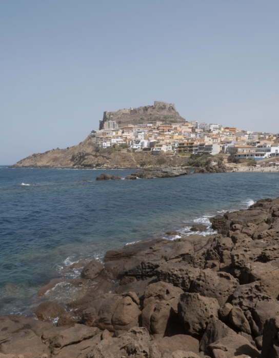
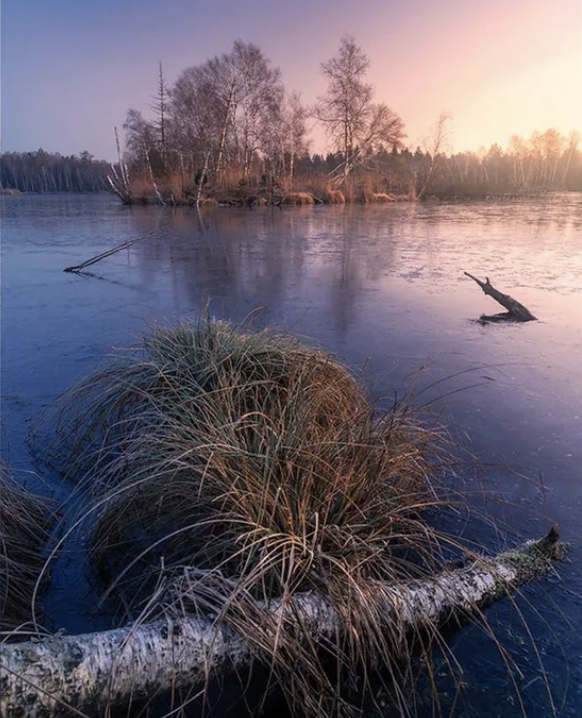
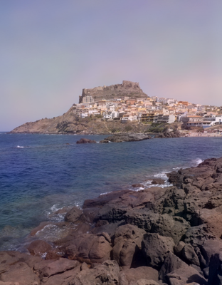

# Mood-Based Photo Style Transfer

A PyTorch tool that pushes a photo toward the color and texture "mood" of a
*set* of reference images, rather than a single style image. Built on the
classic neural style transfer approach (Gatys et al., 2015): a frozen,
pretrained VGG16 extracts features, Gram matrices capture style/texture at
several depths, and an input image is optimized against a weighted
content + style loss until it matches the content's structure but the
references' look.

## How it works

1. A content photo is loaded and its VGG16 features are extracted at a
   mid-depth layer (`conv4_2`) — this captures structure/objects, not exact
   pixels.
2. Every image in a **mood folder** (e.g. `moods/dusk/`) is run through the
   same network, and its Gram matrices are computed at five layers spanning
   shallow (color/edges) to deep (complex texture/pattern).
3. The Gram matrices from all reference images are **averaged** — this is
   the actual "learned mood": the target isn't pulled toward any single
   photo, but toward the shared color/texture statistics of the whole set.
4. Starting from the content image, pixels are optimized (Adam) to minimize
   `content_weight * content_loss + style_weight * style_loss` until the
   result keeps the original composition but takes on the mood's palette
   and texture.
5. **Frequency blend.** Gram-matrix style transfer also copies the
   references' fine textures (e.g. grass strands painted across the sky).
   Since a mood is mostly low-frequency (palette, tone, soft color shifts)
   and those textures are high-frequency, the final image combines the
   *low-pass* of the stylized result with the *high-pass* of the original
   photo (Gaussian, σ = `--detail-sigma`): the mood transfers, the copied
   textures don't, and the photo keeps its own sharp detail.

## Usage

```bash
pip install -r requirements.txt

python style_transfer.py \
  --content examples/input.png \
  --style-dir moods/dusk \
  --output examples/output.png
```

Build your own mood by dropping a handful of reference photos (a consistent
color grade, film look, etc.) into a folder and pointing `--style-dir` at
it — the more images, the more the result reflects the shared mood instead
of one photo's quirks.

### Options

| Flag | Default | Description |
|---|---|---|
| `--content` | required | Path to the photo to restyle |
| `--style-dir` | required | Folder of reference images defining the mood |
| `--output` | `output.png` | Where to save the result |
| `--steps` | `2000` | Optimization steps |
| `--style-weight` | `1e6` | Weight on style loss |
| `--content-weight` | `1.0` | Weight on content loss |
| `--max-size` | `400` | Longest image side, in pixels |
| `--detail-sigma` | `8` | Low/high-frequency split for the final blend; `0` = raw style transfer output |
| `--device` | auto | `cpu`, `cuda`, or `mps` |
| `--show` | off | Display the result when done |

## Example

| Input photo | Mood reference (`moods/dusk/`) | Output |
|---|---|---|
|  |  |  |

The output keeps the input's composition and detail but takes on the dusk
reference's palette (generated with the command above and default settings).

## Project layout

```
style_transfer.py     # the whole pipeline: features, Gram matrices, optimization, frequency blend
moods/<name>/         # one folder of reference images per mood
examples/             # sample input and its generated output
```

## Notes / next steps

- Currently a single content image per run; batching a folder of photos
  through one mood would be a natural extension.
- Optimizing pixels directly (as here) is slower than a feed-forward
  style-transfer network trained once per mood — that's the next step if
  interactive/real-time use is needed.
